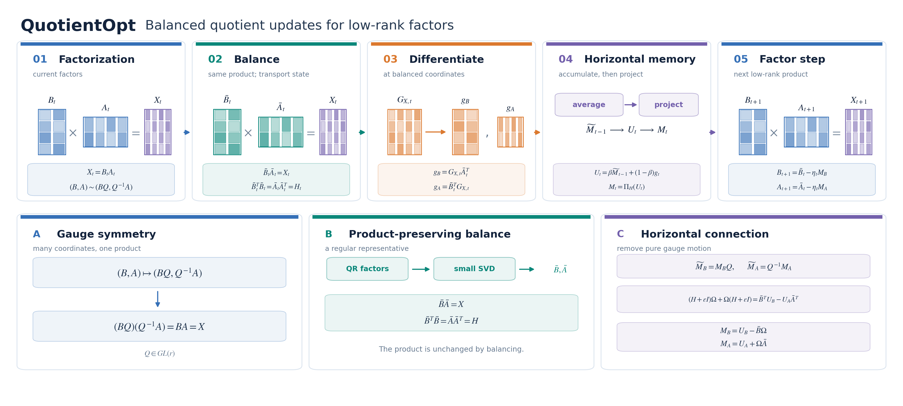

<div align="center">
  <h1>QuotientOpt: Gauge-Invariant Low-Rank Optimization</h1>
  <p><strong>Balanced Quotient Geometry, Convergence, and Generalization</strong></p>
  <p>
    <a href="paper/main.pdf"></a>
    <a href="#quickstart"></a>
    <a href="experiments/full_proposal/geometry_torch.py"></a>
    <a href="#experiments"></a>
  </p>
  <p>Research code for balanced quotient optimization of low-rank factors with gauge-consistent momentum.</p>
</div>

> Many factor pairs represent the same matrix. QuotientOpt balances the representative, transports persistent state, and removes update motion along the gauge orbit.

<p align="center">
  <a href="assets/quotientopt_method_overview.png"></a>
</p>

The manuscript is an ICML-style working draft. Its local 2027 draft adapter uses the official ICML 2026 style and does not imply conference acceptance.

Low-rank products admit many factorizations: $X=BA=(BQ)(Q^{-1}A)$. QuotientOpt first balances the factors without changing $X$, transports persistent momentum to the balanced coordinates, and projects the update onto the horizontal space. The projection solves a small Sylvester equation, removing motion that only changes the factor representation.

## What is in this repository

| Directory | Contents |
|:--|:--|
| [`experiments/`](experiments/) | All experiment and numerical-test source code, including the full-grid generator, task runners, campaign variants, and analysis builders. |
| [`paper/`](paper/) | Manuscript source, bibliography, style files, tables, figures, and compiled PDF. |
| [`figures/`](figures/) | Plotting scripts, including the code for the intuition diagram above. |
| [`figure_code/`](figure_code/) | Standalone code and compact curve data for the two central loss figures. |
| [`examples/`](examples/) | A small synthetic configuration for a local smoke run. |

Generated datasets, full training trajectories, checkpoints, and machine-specific logs are intentionally outside the source repository. The paper records selection rules and complete comparison tables, including mixed outcomes.

## Quickstart

Use Python 3.10 or newer. A CPU-only synthetic smoke run needs no downloaded benchmark data.

```bash
python -m venv .venv
source .venv/bin/activate
python -m pip install -r requirements.txt
python experiments/full_proposal/run.py examples/matrix_sensing_smoke.json \
  --device cpu --smoke-epochs 2 --output outputs
```

The run writes `config.json`, checkpoints, and `trajectory.jsonl` under `outputs/<run-id>/`. A smoke run verifies the code path; it is **not** a paper result. To run the complete horizon for a configuration, omit `--smoke-epochs` and set the desired `epochs` in the JSON file.

For vision, graph, and language benchmarks, install the additional dependencies in [`requirements-benchmarks.txt`](requirements-benchmarks.txt). The loaders are in [`experiments/full_proposal/datasets_full.py`](experiments/full_proposal/datasets_full.py). Set `QUOTIENT_DATA` to choose a cache directory; set `QUOTIENT_VISION_DATA` to use an existing CIFAR cache. Dataset downloads and access requirements remain those of the original data providers.

```bash
export QUOTIENT_DATA="$PWD/datasets"
python experiments/full_proposal/run.py path/to/config.json --device cuda:0 --output outputs
```

## Method

For balanced factors $(\bar B,\bar A)$ with shared Gram matrix $H=\bar B^\top\bar B=\bar A\bar A^\top$, a provisional factor update $U=(U_B,U_A)$ is projected by solving

$$
H\Omega+\Omega H=\bar B^\top U_B-U_A\bar A^\top,
\qquad
\Pi_H(U)=(U_B-\bar B\Omega,\;U_A+\Omega\bar A).
$$

The PyTorch implementation is [`experiments/full_proposal/geometry_torch.py`](experiments/full_proposal/geometry_torch.py). [`experiments/geometry.py`](experiments/geometry.py) contains the earlier NumPy geometry implementation and [`experiments/tests/test_numerics.py`](experiments/tests/test_numerics.py) its numerical checks.

## Experiments

The code covers synthetic matrix sensing and completion, deep linear networks, graph learning, implicit neural representations, scientific ML, vision, and language modeling. [`experiments/full_proposal/grid.py`](experiments/full_proposal/grid.py) defines the proposal grid. The original exhaustive grid is much larger than the completed evidence in the manuscript; treat the generator as a protocol definition, not a claim that every configuration was run.

The manuscript reports favorable comparisons on several specified Cora/GCN, SDF/SIREN, and Poisson/PINN protocols, alongside close balance-only controls and mixed results in other families. Checkpoint selection uses validation metrics; held-out test outcomes are read after selection. See the [experiment section](paper/sections/5_experiments.tex) and [full protocol](paper/sections/full_protocol.tex) for the exact settings and denominators.

Prespecified campaign configurations are in the `plan.json` files beside their corresponding runners. Results are keyed by a hash of the complete configuration. The full-grid worker and multi-device launch scripts are intended for dedicated compute and can generate many long runs; the quickstart above is the small local entry point.

## Figures and paper

Regenerate the README method overview:

```bash
python figures/draw_method_overview.py
```

Regenerate the two main loss figures from the bundled compact curve data:

```bash
python figure_code/plot_core_figures.py
```

The other plot builders remain in `experiments/full_proposal/build_*.py` and `analysis/plot_replacement.py`. They use full result records, which are not included in this source release. Pre-rendered PDF figures are included in `paper/figures/` so the paper can compile directly:

```bash
cd paper
latexmk -pdf main.tex
```

The entry point is [`paper/main.tex`](paper/main.tex). The adapter `icml2027_draft.sty` loads the bundled official `icml2026.sty`; it is explicitly a working-draft style, not an official 2027 template.

## Reproducibility notes

- Every formal run writes its configuration, per-epoch trajectory, validation-selected checkpoint, final metrics, and source hashes.
- The focused Poisson follow-up varies model initialization over 42, 43, and 44 while keeping its data and shuffle seed fixed at 42.
- Some campaigns include stopped numerical trials and recovery variants. Their source code and protocols are retained rather than folding them into successful-run counts.
- The repository publishes source and compact figure inputs. It does not publish downloaded datasets or model checkpoints.

